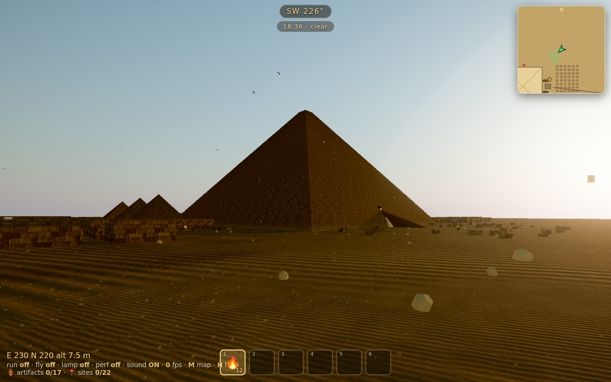
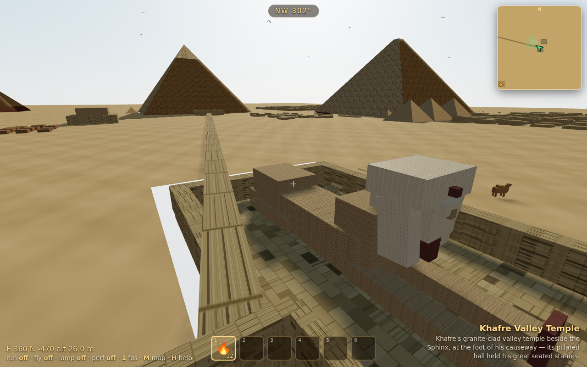
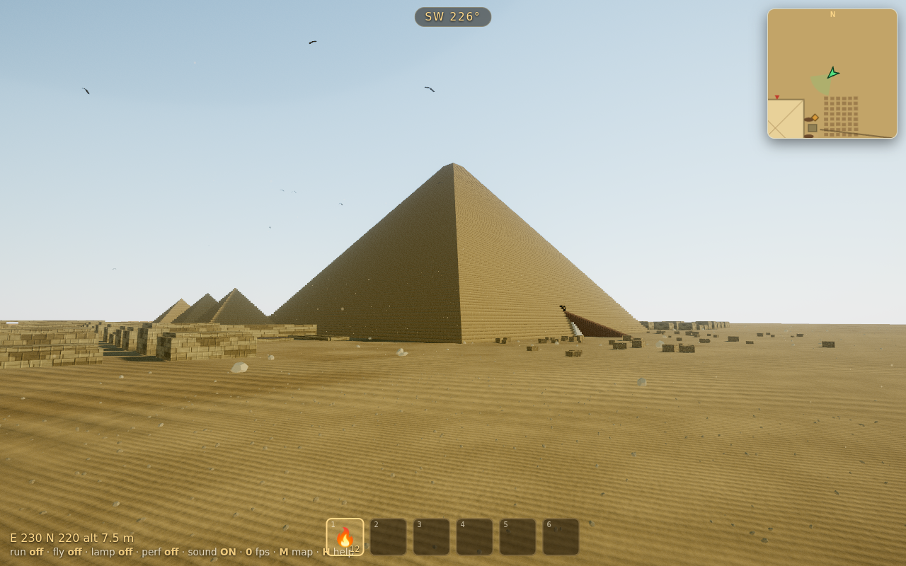

# The Giza Plateau — To-Scale Explorable Simulation

A browser-based, **1:1 scale**, fully playable 3D reconstruction of the Giza
Plateau with **physics-based first-person exploration**. Every monument is
built from real survey data, and the pyramids are **explorable inside** with
authentic passage systems and chambers.





## Run it

This is a static site (Three.js via CDN). It must be served over HTTP because
it uses ES modules + an import map — opening `index.html` from `file://` will
not work.

```bash
# any of these, from the project root:
npx serve -l 8080 .        # Node
python3 -m http.server 8080 # Python
```

Then open <http://localhost:8080>.

## Controls

| Key | Action |
| --- | --- |
| `W A S D` / arrows | Move |
| Mouse | Look (click to capture the pointer) |
| `Space` | Jump (or ascend while flying) |
| `Shift` | Sprint |
| `C` / `Ctrl` | Descend while flying |
| `F` | Toggle **fly / no-clip** (great for covering the 230 m pyramids) |
| `L` | Toggle **headlamp** (needed inside the passages) |
| `M` | **Full map** — click anywhere to fast-travel |
| `1`–`6` / wheel | Select an inventory slot |
| Click / `E` | **Use item**: place or pick up a torch; pick up a stone from the ground / throw it |
| `V` | Toggle sound (wind, footsteps, stone impacts) |
| `T` / `[` `]` | Cycle time of day (dawn → night) / shift by an hour. Time also passes on its own (1 h ≈ 5 min) |
| `K` | Call up (or dismiss) a sandstorm — they also roll in on their own every few minutes |
| `P` | Performance mode (no shadows / post-processing) |
| `H` | Help / real-world facts |
| `Esc` | Release the mouse |

**On phones/tablets** (no pointer lock): tap **Tap to start**, then use the
on-screen **joystick** (left) to move, **drag** anywhere on the right to look,
and the **JUMP / RUN / FLY / LAMP / MAP** buttons. A compass shows your heading,
and your **headlamp turns on automatically** whenever you go inside a pyramid.

## Things to do

- **Ride a camel.** Saddled camels wait by the Sphinx, on the Great Pyramid's
  north side and at the panorama viewpoint: walk up and press `E`.
- **Stay for the Sound & Light show.** After dark, coloured floodlights on the
  Sphinx terrace sweep the Sphinx and the three pyramids.
- **Climb the Great Pyramid.** The stepped core is real collision geometry:
  walk up the smaller courses, jump the tall ones, and stand on the flat
  summit 139 m up. (Please don't do this in real life.)
- **The artifact hunt.** Seventeen artifacts — each a real class of object
  associated with that spot — glow at sites all over the plateau, from the
  King's Chamber to the workers' bakeries. Walk over one to collect it and
  read what it is. The full map (`M`) shows undiscovered ones as gold stars.
- **Discover every site**, earn the achievements (`H` lists them), watch the
  sun set over Khafre, see the Milky Way come out, and get caught in a
  sandstorm. Progress is saved in your browser.

## Built from real satellite and aerial data

The layout is not hand-placed: `tools/geo/build_geodata.py` pulls open data
and bakes it into `js/geodata.js` plus three images in `assets/geo/`.

- **Pyramid spacing** follows Petrie's 1880–82 triangulation: Khafre's centre
  is 486.9 m from Khufu's, Menkaure's 936.2 m. The mapped footprints agree to
  within ~1.5 m, and `npm test` checks the layout.
- **Positions** of the queens' pyramids, the Sphinx, the temples,
  Khentkaus, the boat pits and the Wall of the Crow come from their mapped
  footprints (OpenStreetMap, traced from aerial imagery), projected onto a
  local metre grid centred on the Great Pyramid.
- **Topography** is the Copernicus 30 m elevation model, with buildings and
  monuments filtered out and Y = 0 set at Khufu's base. So the real lie of the
  land is there: Khafre stands ~9 m higher than Khufu (which is why it looks
  taller), Menkaure ~12 m higher, and the Sphinx sits at the foot of the
  escarpment in a pit ~42 m below Khufu's base, with the causeways climbing
  40–50 m from the valley temples to the pyramids.
- **~580 tomb footprints** in the Western and Eastern cemeteries, south of
  Khufu and in the Central Field are built from their mapped outlines, sizes
  and orientations (including named ones such as Hemiunu's tomb); the mapped
  outlines of Khafre's mortuary temple and Menkaure's valley temple become
  their walls.
- **The modern town** (Nazlet el-Samman and the Pyramids-road districts) is
  extruded from ~1,850 mapped building outlines. Storey counts come from the
  surface model (DSM minus bare earth), every roof takes the colour the
  satellite sees at that spot, and the facade style follows it: red brick
  infill in a concrete frame (the typical unfinished Cairo block), plastered
  and painted, or bare concrete — with shop shutters, parapets, stair huts,
  water tanks, rebar left for the next storey, and windows that light up at
  dusk. The modern cemetery south of the Sphinx is built from its own tombs.
- **Ground colour** is a cloud-free Sentinel-2 composite (July 2025) used as a
  macro colour layer under the procedural sand, so gravel spreads, wadis,
  fields and the golf course are where they really are; **roads and tracks**
  are painted from the mapped road network; **palms** grow wherever the
  satellite sees vegetation. The full map (`M`) uses the satellite image as
  its base layer.

Sources and licences are listed in [`tools/geo/README.md`](tools/geo/README.md).
Map data © OpenStreetMap contributors (ODbL), via Overture Maps. Contains
modified Copernicus Sentinel data 2025. Copernicus GLO-30 DEM © DLR e.V.
2010–2014 and © Airbus Defence and Space GmbH 2014–2018, provided under
COPERNICUS by the European Union and ESA.

## Blender models, inscriptions and the research tracker

- **Blender pipeline.** Sites that deserve real modelling are built by Blender
  scripts (`tools/blender/`, run with `pip install bpy`), exported as GLB with
  the lighting baked in by Cycles, and loaded by `js/models.js`. First site:
  the **Serapeum of Saqqara** — the Apis-bull catacombs 13.6 km south of Giza
  (fast-travel to it): a ~360 m rock-cut gallery system with 24 stone
  sarcophagi at their published size (3.85 × 2.32 × 2.32 m, 0.98 m lids), in
  sunken vaulted chambers, lit by floor tubes as it is today, including the
  boxes of Amasis II, Cambyses II and Khabash and the scratched Ptolemaic
  box with its empty cartouches.
- **Hieroglyphs.** Inscriptions are drawn from real Unicode hieroglyphs
  (`js/inscriptions.js`, Noto Sans Egyptian Hieroglyphs, SIL OFL), written in
  Gardiner sign codes, each marked `attested`, `composed` (from a published
  translation) or `placeholder`.
- **Research tracker.** [`research/`](research/README.md) records, per site,
  what has been researched (with sources), what was built from it, and what
  is still open — read it before researching, update it after.

## What's modelled

**To scale, at their mapped positions and real ground levels:**

- **Great Pyramid of Khufu** — base 230.4 m, original height 146.6 m, face
  slope 51°50′.
  - Full interior: original north-face entrance (reached by a stair/ramp) →
    **Descending Passage** → **Ascending Passage** → **Grand Gallery**
    (46.7 m long, 8.6 m tall) → **King's Chamber** (red granite, 10.47 × 5.23 m
    with the granite sarcophagus) — all **walkable end-to-end on foot** as one
    continuous corridor. Branches lead to the **Queen's Chamber** and the
    **Subterranean Chamber** cut into the bedrock.
- **Pyramid of Khafre** — base 215.25 m, slope 53°, with surviving casing
  near the apex; descending passage to a burial chamber.
- **Pyramid of Menkaure** — base 102.2 m, with its red-granite lower courses;
  descending passage to a burial chamber.
- **Subsidiary "queens'" pyramids** of Khufu and Menkaure.
- **The Great Sphinx** — 73 m long, 20 m high, 19 m across the haunches,
  facing due east. It is sculpted as a single weathered surface (a signed
  distance field polygonised at load): the lion body with its folded hind
  legs and curled tail, the long re-cased forelegs and paws, the king's face
  under the nemes headcloth that narrows over the crown and flares to the
  shoulders, the missing nose, and the deep horizontal erosion bands of the
  soft body layers, with the Dream Stele against its chest.
- Surface details as they stand today: the chevron blocks over Khufu's
  original entrance and al-Ma'mun's robbers' tunnel below it, the gash in
  Menkaure's north face, rubble aprons around the bases, burial-shaft mouths,
  false doors and broken tops on the mastabas, tour buses in the mapped car
  parks, visitors who walk the famous spots (swinging arms and legs), horse
  carriages and led camel rides plying the mapped site roads, the surveyors'
  mast on Khufu's summit marking its original height, the Sphinx enclosure's
  rough quarried rock walls, and high cirrus that colours with the sunset.
- **Mastaba cemeteries** (the Eastern and Western fields of street-gridded
  tombs around the Great Pyramid, from their mapped footprints), **causeways**
  climbing from the valley temples to the mortuary temples, Khafre's granite
  **valley temple** and the **Sphinx Temple**, Amenhotep II's temple, the
  mapped **boat pits** beside Khufu's temple and causeway, surviving **casing
  stones** at the Great Pyramid's base, and a reconstructed **solar boat**.
- A weathered desert plateau, late-afternoon physical sky, sun shadows,
  scattered fallen casing blocks, **palm groves**, **camels** by the Sphinx,
  and **birds** circling overhead.

**Immersion:**

- **Dust** kicks up at your feet when you walk or run on the open plateau,
  with **wind-blown sand** drifting across the site in gusts.
- **Pebbles and rocks** litter the ground everywhere (a dense field follows
  you around, with larger rocks and boulders scattered plateau-wide).
- **Throwable stones** — pick them up off the ground, throw them, watch them
  bounce off the monuments and raise a puff of dust, then collect them again.
- Cinematic **post-processing** (bloom, warm colour grade, vignette, film
  grain), a **sun lens flare**, and a subtle sprint field-of-view kick.
- Procedural **audio**: gusting wind, footsteps that echo inside the
  passages, and stone impacts.

### Notes on accuracy

- Monument **positions** come from mapped footprints and **ground levels** from
  the elevation model; **sizes, orientations and slope angles** are the
  surveyed values. Sites whose remains are buried or unmapped (Khufu's valley
  temple under the village, the workers' cemetery, the Khentkaus town) are
  placed from published plans and are approximate.
- Interior **passage cross-sections are slightly enlarged** (≈1.6 m wide,
  2.2 m tall) so you can walk them upright. The real passages are ~1.0–1.2 m
  and require crouching — the genuine dimensions are listed in the in-game
  **H**elp panel.
- Geometry is procedural (no external 3D assets), so blocks and reliefs are
  suggested with textures rather than individually modelled.

## Tech

- [Three.js](https://threejs.org) for rendering (WebGL).
- Rendering: physical sky feeding a PMREM environment map (image-based
  skylight), sun via 3-cascade shadow maps (CSM), multisampled HDR
  post-processing (bloom, colour grade, vignette, grain, depth-based heat
  shimmer), ACES tone mapping.
- Materials: all procedural — masonry, casing, granite and sand each get a
  colour map, a height-derived normal map and a roughness map. Walls and
  interiors use world-space planar mapping so blocks are the same real size
  on every surface; the sand blends two tiling scales plus large-scale tonal
  and gravel variation so no repeat is visible.
- The pyramids are built course by course (real stepped cores with risers
  and treads, thick at the base and thinning upward); the smooth faces are
  kept invisible as the collision surface.
- [three-mesh-bvh](https://github.com/gkjohnson/three-mesh-bvh) for fast
  capsule-vs-mesh collision (collide-and-slide character physics).
- No build step — plain ES modules loaded from a CDN via an import map.

## Project layout

```
index.html         # import map, UI overlays
styles/main.css    # HUD / menu styling
js/data.js         # survey data: dimensions, positions, interior layout
js/geodata.js      # GENERATED: DEM, mapped sites, tombs, town, palms
js/terrain.js      # real topography: DEM + levelled platforms, height lookup
js/sphinx.js       # the sculpted Sphinx (SDF + surface nets) and its material
js/life.js         # visitors, carriages, camel rides, rideable camels, light show
js/models.js       # loads the Blender-built GLB models, baked-light materials
js/inscriptions.js # hieroglyphic inscriptions (Gardiner codes -> textures)
tools/blender/     # Blender (bpy) model builders -> assets/models/*.glb
research/          # per-site research tracker: sources, done, todo
js/materials.js    # procedural stone / sand textures + materials
js/builders.js     # geometry: pyramid faces, tunnels, rooms, stairs, sarcophagi
js/world.js        # assembles the plateau, terrain, sky and lighting
js/player.js       # collider/BVH build + capsule character controller
js/fx.js           # dust/sand particles, ground debris, lens flare, post-processing, audio
js/main.js         # bootstrap, input, HUD, fast-travel, game loop
assets/geo/        # GENERATED: satellite map, ground colour, road mask
tools/geo/         # the geodata pipeline (Python) and its sources
test/headless.mjs  # Node smoke test for the geometry/physics build
```

## Test

```bash
npm install   # dev-only: three + three-mesh-bvh for the headless test
npm test      # builds the whole world + collider and runs physics frames
```
